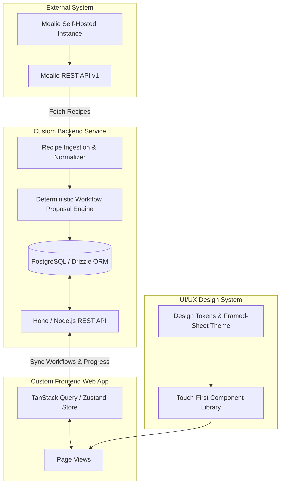
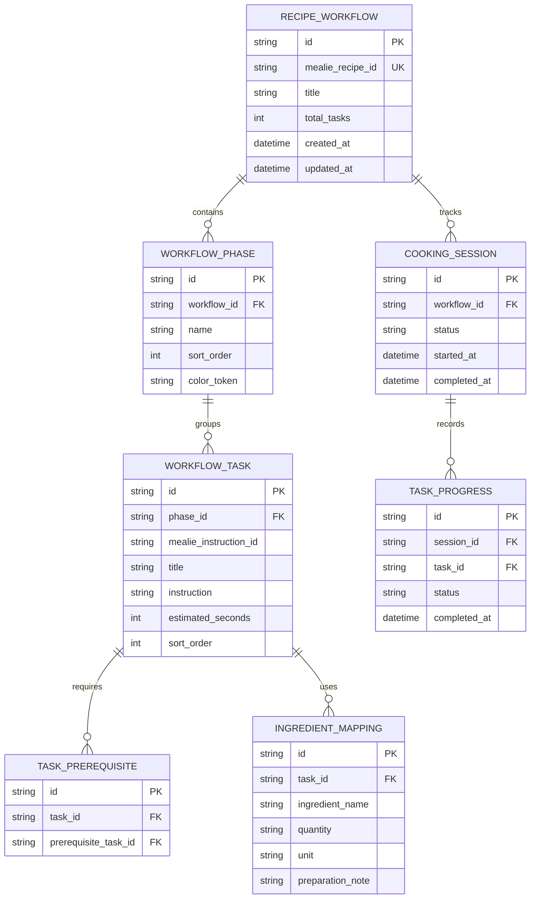
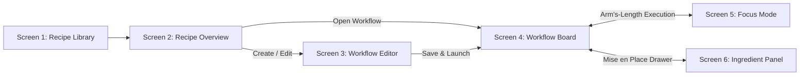
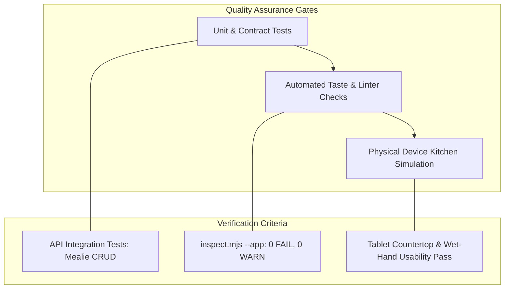

# Kitchen Workflow App — Engineering & Design Build Ledger

This build ledger outlines the execution plan for the **Kitchen Workflow App**, translating the requirements from [`PRODUCT_BRIEF.md`](file:///C:/Users/paw2fajardo/orca/workspaces/kitchensidekick/burbot/PRODUCT_BRIEF.md) and the design tokens and component rules from [`DESIGN.md`](file:///C:/Users/paw2fajardo/orca/workspaces/kitchensidekick/burbot/DESIGN.md) into actionable, segregated engineering workstreams.

---

## Tech Stack Agreement

| Layer | Technology | Selection Rationale |
|---|---|---|
| **Language & Runtime** | **Full-Stack TypeScript (Node.js 22+)** | End-to-end type safety sharing data contracts and schemas across API and client. |
| **Backend Framework** | **Hono (Node.js)** | Ultra-lightweight, high-performance, web-standard HTTP router with built-in OpenAPI & Zod type validation. |
| **Recipe Source** | **Mealie REST API v1** | Source of truth for recipe catalogs, URL ingestion, and base imagery. Unmodified. |
| **Workflow Database** | **PostgreSQL** via **Drizzle ORM** | Relational storage on your server for phases, task dependencies, and cooking sessions. Type-safe, lightweight queries without heavy ORM overhead. |
| **Frontend Framework** | **React 19 + Vite** | Fast dev server, instant HMR, modern hooks, and optimal performance for reactive cooking timers. |
| **Styling & Design Tokens** | **Tailwind CSS v4** | Pure CSS token integration matching [`DESIGN.md`](file:///C:/Users/paw2fajardo/orca/workspaces/kitchensidekick/burbot/DESIGN.md) without extra build-chain complexity. |
| **Component Primitives** | **Radix UI** | Unstyled, accessible UI primitives (Dialog, Popover, Collapsible, Checkbox, Slider) styled directly with design tokens. |
| **Client State & Caching** | **TanStack Query v5 + Zustand** | Query cache for Mealie sync and workflow state; Zustand for real-time cooking timers and offline local-save persistence. |
| **Audio Alert Engine** | **Web Audio API** | Zero-asset synthetic chime generation at 00:00 timer expiry (reliable on all browsers with no audio file asset dependencies). |
| **Screen Management** | **Screen WakeLock API** | Native `navigator.wakeLock` integration keeping kitchen tablet screens awake during active cooking. |

---

## Architecture Overview

---

## 1. Backend Workstream

### 1.1 Responsibilities & Boundaries
- Integrate with the self-hosted **Mealie REST API** for recipe retrieval, search, and image proxying.
- Own custom workflow data structures: recipe phases, tasks, ingredient-to-task mappings, task-to-task prerequisites, and active cooking session progress.
- Never mutate Mealie's core recipe data model. Preserve original instruction IDs and ingredient references.

### 1.2 Data Schema

### 1.3 Implementation Tasks

| Task ID | Item | Description | Dependencies | Definition of Done |
|---|---|---|---|---|
| **BE-01** | Mealie API Client | HTTP client connecting to Mealie (`GET /api/recipes`, `GET /api/recipes/{slug}`). Handles auth tokens, connection failures, and error responses. | None | Unit tests verify parsing of Mealie recipes and network failure fallbacks. |
| **BE-02** | Recipe Normalizer | Ingestion pipeline converting heterogeneous Mealie recipe schemas (instruction strings, ingredient lists, group headers) into standardized internal representations. | BE-01 | Normalizer outputs consistent recipe AST preserving original instruction IDs. |
| **BE-03** | Deterministic Workflow Generator | Heuristic/rule-based parser proposing initial workflow phases (Prep, Sauce, Cooking) and grouping instructions into tasks. | BE-02 | Sukiyaki sample recipe deterministically produces the canonical 3-phase, 14-task proposal. |
| **BE-04** | Database & Persistence Layer | Relational storage schema (PostgreSQL via Drizzle ORM) for workflows, phases, tasks, prerequisites, and ingredient mappings. | None | Migrations executed; CRUD repository tests pass for full workflow graph. |
| **BE-05** | Workflow Management API | REST endpoints: `GET /api/workflows/{id}`, `POST /api/workflows` (generate), `PUT /api/workflows/{id}` (save edits), `DELETE /api/workflows/{id}`. | BE-03, BE-04 | Endpoints validated with OpenAPI schema and integration tests. |
| **BE-06** | Session & Cooking State Engine | Endpoints for active cooking sessions: `POST /api/sessions` (start), `PATCH /api/sessions/{id}/tasks/{taskId}` (toggle complete/ready), `GET /api/sessions/{id}`. | BE-05 | Dependency graph automatically calculates task readiness (`Blocked` vs `Ready`) upon prerequisite task completion. |
| **BE-07** | Local Cache & Offline State Sync | Support client-side idempotent state reconciliation using task completion event streams (`task_id`, `completed_at`). | BE-06 | Offline task updates replay and merge cleanly without race condition overwrites. |

---

## 2. Frontend Workstream

### 2.1 Responsibilities & Boundaries
- Build a responsive, touch-first Single Page Application (React + Vite + TypeScript + Tailwind CSS).
- Optimize for kitchen use on 10–13 inch landscape tablets, mobile phones, and desktop browsers.
- Provide fluid client-side routing, offline resilience via service workers or localStorage caching, and persistent session recovery.

### 2.2 Screen Implementation Matrix

### 2.3 Implementation Tasks

| Task ID | Item | Description | Dependencies | Definition of Done |
|---|---|---|---|---|
| **FE-01** | App Shell & Framed-Sheet Layout | Root app layout implementing the `framed-sheet` aesthetic: L-shaped tinted frame (`#F5F5F0`), white content sheet with 1px hairline border (`#D9DDD4`), soft 16px corners, and 0px shadow. | None | Layout renders correctly at 1440px, 1024px, 768px, and 390px. |
| **FE-02** | State Management & Query Layer | TanStack Query + Zustand setup for server cache, active session progress, timer states, and offline persistence. | None | State persists across page refreshes and offline reloads. |
| **FE-03** | Screen 1: Recipe Library | Search bar, recipe cards with 4:3 images, title, total time, servings, and "Workflow exists" indicator. | BE-01, FE-01 | Cook can search, filter, and select recipes from Mealie. |
| **FE-04** | Screen 2: Recipe Overview | Read-only recipe view with metadata, ingredients grouped by component, original instructions, and "Start Cooking" / "Edit Workflow" CTAs. | BE-02, FE-01 | Recipe overview displays correctly; routes directly to Board or Editor. |
| **FE-05** | Screen 3: Workflow Editor | Interactive editor to add/rename/reorder phases, edit tasks, associate ingredients, and configure task-to-task dependencies without requiring drag-and-drop. | BE-05, FE-01 | Cook can customize phases, tasks, and prerequisites; save generates updated workflow. |
| **FE-06** | Screen 4: Workflow Board (Primary) | Multi-column lane board (Prep, Sauce, Cooking) with sticky lane headers, task cards showing status, ingredients, and explicit prerequisite blocker jump links. | BE-06, FE-01 | Multi-lane board displays parallel streams; clicking a prerequisite scrolls and focuses the blocker. |
| **FE-07** | Screen 5: Focus Mode (Cooking) | Single-task glanceable interface with 22px instruction text, sequential timer countdown ring, tactile "Flip" action, and 56px bottom completion CTA. | BE-06, FE-01 | Cooks can advance, pause/resume timers, flip, override, and step backward via persistent bidirectional navigation. |
| **FE-08** | Screen 6: Ingredient Panel | Collapsible side panel (tablet) / bottom sheet (phone) tracking binary `Pending` vs `Prepared` mise en place items with links to mapped tasks. | BE-06, FE-01 | Checkbox updates ingredient state without blocking task execution. |
| **FE-09** | Multi-Stage Timer Engine | Client-side timer manager supporting sequential multi-stage timers (e.g. 2:00 side A -> flip -> 2:00 side B), +30s extensions, and web audio chime alert at 00:00. | None | Timer accurately counts down, triggers audio at 00:00, and prompts stage advance without auto-completing task. |
| **FE-10** | WakeLock Integration | `navigator.wakeLock` integration keeping screen awake in Focus Mode, with visual fallback indicator if revoked. | FE-07 | Screen stays awake; warning pill displays if battery saver releases lock. |

---

## 3. UI/UX Design System Workstream

### 3.1 Responsibilities & Boundaries
- Enforce strict adherence to [`DESIGN.md`](file:///C:/Users/paw2fajardo/orca/workspaces/kitchensidekick/burbot/DESIGN.md) design tokens and component contracts.
- Guarantee WCAG 2.2 AA accessibility (minimum 4.5:1 text contrast, minimum 3:1 non-text contrast).
- Ensure kitchen-first ergonomics: arm's-length legibility (minimum 16px body, 20–24px instructions), minimum 48px touch targets, and zero continuous motion slop.

### 3.2 Design System Tokens & Specs

| Token Category | Token / Rule | Value | Enforced Behavior |
|---|---|---|---|
| **Canvas & Ground** | `color.canvas` | `#F5F5F0` | Warm off-white app background |
| **Surface** | `color.surface` | `#FFFFFF` | Cards, panels, modal dialogs; flat, 0px shadow |
| **Dividers & Borders** | `color.border` | `#D9DDD4` | 1px hairline stone border across cards and lanes |
| **Primary Brand** | `color.primary` | `#245C43` | Deep forest green for primary actions, active tabs, countdown rings |
| **Phase Accents** | `phase.prep` `phase.sauce` `phase.cooking` | `#537B60` `#B17A3D` (`#8A5A22` text) `#A65B45` | 4px left-border accent markers on cards; never used as button fills |
| **Touch Standards** | Action Targets | $\ge 48\text{px} \times 48\text{px}$ | Minimum touch bounding box for all interactive controls |
| **Primary CTAs** | Completion Buttons | $\ge 56\text{px}$ height | Arm's-length tap target for primary kitchen actions |
| **Motion Constraint** | Looping Animations | Strictly prohibited | No `animate-pulse` or `animate-ping` on running status indicators |

### 3.3 Implementation Tasks

| Task ID | Item | Description | Dependencies | Definition of Done |
|---|---|---|---|---|
| **UX-01** | Tailwind Token Configuration | Configure `tailwind.config.js` with exact hex tokens, font scales, spacing, and radius variables from [`DESIGN.md`](file:///C:/Users/paw2fajardo/orca/workspaces/kitchensidekick/burbot/DESIGN.md). | None | All utility classes map directly to canonical tokens (`bg-canvas`, `text-primary`, `border-border`). |
| **UX-02** | De-Nested Task Card Component | Build flat, high-contrast Task Card component with 4px phase left-border, status icon + label, ingredient tags, and 0px nested sub-cards. | UX-01 | Cards pass automated `inspect.mjs --app` with zero `nested-cards` warnings. |
| **UX-03** | 1024px Responsive Collapse Engine | Implement responsive layout engine that automatically shifts Workflow Board from 2 lanes to 1 lane with a sticky segmented switcher when the ingredient drawer opens at 1024px. | UX-01 | Viewport never clips horizontally at 1024px iPad landscape width. |
| **UX-04** | Tactile Touch Target Audit | Audit every interactive button, chip, tab, checkbox, and override link to enforce minimum 48px touch targets and 8px gutter separation. | UX-01 | Zero touch targets under 48px; manual override buttons validated for wet-hand ease. |
| **UX-05** | Steady-State Status Indicators | Implement static icon + label status badges for `Pending`, `Ready`, `In progress`, `Blocked`, and `Completed` with zero continuous motion. | UX-01 | Status badges display crisp, steady indicators without peripheral movement. |
| **UX-06** | High-Legibility Typography Audit | Verify font sizes across mobile and desktop: Section headers 20–24px, Task titles 18–22px, Instructions 20–24px, Body text 16–18px. | UX-01 | All text legible from 3–4 feet away on countertop mockups. |
| **UX-07** | WCAG 2.2 AA Contrast Compliance | Automated contrast audit verifying all text/background pairs meet 4.5:1 (3:1 for large text), specifically checking warning text and phase labels. | UX-01 | Automated contrast check passes 100% across all views. |

---

## 4. Verification & Testing Matrix

1. **Backend Integration**: Verify automated conversion of Mealie recipes into deterministic 3-phase workflows with complete task prerequisite resolution.
2. **Automated Design Quality Gate**: Execute `inspect.mjs --app` and `impeccable detect` to verify:
   - Zero nested cards (`nested-cards`).
   - Zero continuous pulsing animations (`pulsing-dot`).
   - Clean typographic scale steps without flat hierarchy (`flat-type-hierarchy`).
   - Explicit semantic `<h1>` on every screen.
3. **Kitchen Usability Verification**:
   - Verify arm's-length legibility at 3–4 feet on an iPad landscape display.
   - Verify one-handed completion and manual timer overrides without misclicks.

---

## 5. UI/UX Intelligibility Rework & Anti-Slop Ledger (Phase 2 Addendum)

### 5.1 Problem Statement & Architectural Pivot
Following heuristic testing and kitchen usability feedback, the multi-column kanban board (Prep, Sauce, Cooking) beneath a massive hero card was diagnosed as causing severe cognitive fatigue for home cooks. The 6 peer tabs (`1. Library`, `2. Overview`, `3. Editor`, `4. Board`, `5. Focus`, `6. Mise en Place`) conflated preparation, configuration, and high-heat stove execution.

### 5.2 Implementation Tasks

| Task ID | Domain | Item | Description | Definition of Done | Status |
|---|---|---|---|---|---|
| **RW-01** | Frontend Architecture | Dual Operating Modes in `AppShell` | Replace 6-tab peer ribbon with two operational modes: **Mode 1 (Preparation & Staging)** with Library/Overview, and **Mode 2 (Active Cooking Console)** with dedicated cooking safety controls (`Exit Cooking`). | `AppShell.tsx` renders focused headers depending on cooking state; zero editing risk at the stove. | **Completed** |
| **RW-02** | UX / Ergonomics | Unified Active Cooking Console | Retire `WorkflowBoard` and `FocusMode` split. Build 70/30 countertop layout (`ActiveCookingConsole.tsx`) pairing a 70% Command Deck (24–32px typography, 64px primary CTA) with a 30% chronological timeline ("Up Next"). | Single glanceable execution screen; 0 nested cards; 100% compliant with arm's-length reading distance. | **Completed** |
| **RW-03** | State & Timers | Unified Timer Engine | Remove disconnected local `useState` timers from board and focus screens. Bind all active step timers exclusively to `timerStore`. | Starting, pausing, or extending timers in the active step synchronizes across the `GlobalTimerStrip`, persistent storage, and Web Audio alert. | **Completed** |
| **RW-04** | Backend / API | Recipe Slug Ingestion Proxy | Implement `GET /api/recipes/:slug` proxying to Mealie REST v1 with canonical Sukiyaki fallback. | Allows dynamic retrieval and ingredient AST normalization for all 37 recipes in Mealie. | **Completed** |
| **RW-05** | Frontend Ingestion | End-to-End Workflow Generation | Wire "Generate Workflow" and "Open Workflow" in `RecipeLibrary.tsx` through `App.tsx` to invoke `POST /api/workflows` and load recipe-specific phases and tasks. | Clicking any recipe card dynamically generates and loads that recipe's custom parallel phases, ingredients, and task dependencies. | **Completed** |
| **RW-06** | Design Quality Gate | Anti-Slop "Side-Tab" Elimination | Remove thick `border-l-4` side-tab accent borders from `TaskCard`, `ActiveCookingConsole`, `FocusMode`, and `WorkflowBoard` per `impeccable detect` slop rules. | `.agents/skills/impeccable/scripts/impeccable detect --json src/` returns `[]` (0 slop findings). | **Completed** |
| **RW-07** | Cooking Execution | Meal Completion Celebration Screen | Handle the final step completion CTA ("Complete last step and finish meal") by transitioning to a dedicated `CookingCompleteCelebration` screen with summary metrics, "Cook Again", and "Recipe Library" navigation. | Cook can finish the session and smoothly return to the library or restart. | **Completed** |

### 5.3 Quality Gate Validation Results
- **Unit & Integration Tests**: 38/38 tests passing across 9 test suites (`npm test -- --run` exits 0).
- **Build Verification**: `npm run build` (`tsc && vite build`) compiles cleanly with 0 TypeScript or bundler errors.
- **Impeccable Mechanical Detector**: `impeccable detect --json src/` yields **0 warnings, 0 slop detections**.
- **Taste Linter**: `inspect.mjs public/taskcard-verify.html --app` yields **0 FAIL**.

