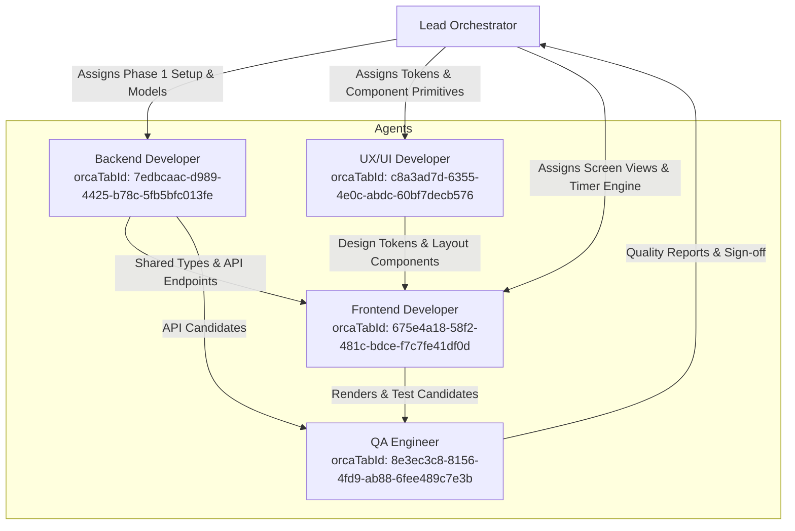

# Kitchen Workflow App — Orchestration & Agent Delegation Roster

This document records the agent delegation roster and task mappings from [`BUILD_LEDGER.md`](file:///C:/Users/paw2fajardo/orca/workspaces/kitchensidekick/burbot/BUILD_LEDGER.md). When continuing or resuming work across sessions, the Lead Orchestrator coordinates these agents.

---

## 1. Active Agent Directory

| Agent Role | Target Domain / Scope | Identifier / Channel |
|---|---|---|
| **Lead Orchestrator** | Coordinates workflows, unblocks dependencies, reviews outputs, and advances phases. | Primary Session |
| **Backend Developer** | Hono API, Mealie Client, Normalizer, PostgreSQL via Drizzle ORM, Session Engine. | `orcaTabId: 7edbcaac-d989-4425-b78c-5fb5bfc013fe` |
| **Frontend Developer** | React 19 + Vite, TanStack Query, Zustand, Screens 1–6, Timer Engine, WakeLock. | `orcaTabId: 675e4a18-58f2-481c-bdce-f7c7fe41df0d` |
| **UX/UI Developer** | Tailwind CSS v4, Radix UI Primitives, `framed-sheet` styling, Touch Audits, WCAG AA. | `orcaTabId: c8a3ad7d-6355-4e0c-abdc-60bf7decb576` |
| **QA / Quality Engineer** | Automated testing, `inspect.mjs --app` taste gate, API integration & touch device validation. | `orcaTabId: 8e3ec3c8-8156-4fd9-ab88-6fee489c7e3b` |

---

## 2. Workstream Allocation & Delegation Map

### Delegation Tasks

#### A. Backend Developer (`orcaTabId: 7edbcaac-d989-4425-b78c-5fb5bfc013fe`)
- **`BE-01`**: Implement Mealie API Client (`GET /api/recipes`, error handling, connection fallbacks).
- **`BE-02`**: Build Recipe Normalizer converting Mealie schema into standardized AST while preserving instruction IDs.
- **`BE-03`**: Build Deterministic Workflow Generator (proposes Prep, Sauce, Cooking phases; Sukiyaki 3-phase canonical test).
- **`BE-04`**: Set up PostgreSQL schema and migrations with Drizzle ORM.
- **`BE-05`**: Implement Workflow Management REST API (`/api/workflows`).
- **`BE-06`**: Implement Session & Cooking State Engine (task prerequisites, `Blocked` -> `Ready` calculation).
- **`BE-07`**: Build local state cache and offline event-merge handler.

#### B. UX/UI Developer (`orcaTabId: c8a3ad7d-6355-4e0c-abdc-60bf7decb576`)
- **`UX-01`**: Configure Tailwind CSS v4 design tokens matching [`DESIGN.md`](file:///C:/Users/paw2fajardo/orca/workspaces/kitchensidekick/burbot/DESIGN.md) (`#245C43`, `#537B60`, `#B17A3D`, `#A65B45`).
- **`UX-02`**: Construct de-nested, flat Task Card component (4px left-border phase marker, 0px nested sub-cards).
- **`UX-03`**: Implement 1024px responsive layout engine (auto-collapse from 2 lanes to 1 lane with sticky switcher when ingredient drawer opens).
- **`UX-04`**: Audit all touch targets ($\ge 48\text{px}$ standard, $\ge 56\text{px}$ for primary CTAs).
- **`UX-05`**: Implement steady-state status badges (no continuous motion / no pulsing dots).
- **`UX-06`**: Enforce arm's-length typography scale (headers 20–24px, titles 18–22px, instructions 20–24px, body 16–18px).
- **`UX-07`**: Verify WCAG 2.2 AA contrast compliance across all color tokens.

#### C. Frontend Developer (`orcaTabId: 675e4a18-58f2-481c-bdce-f7c7fe41df0d`)
- **`FE-01`**: Scaffold React 19 + Vite app shell implementing the `framed-sheet` layout (1px hairline border, 0px shadow).
- **`FE-02`**: Setup TanStack Query v5 + Zustand stores for session, timers, and offline cache.
- **`FE-03`**: Implement Screen 1: Recipe Library (search, cards, workflow indicators).
- **`FE-04`**: Implement Screen 2: Recipe Overview (metadata, component groups, workflow CTA).
- **`FE-05`**: Implement Screen 3: Workflow Editor (phase/task editing, dependency assignment without forced drag-and-drop).
- **`FE-06`**: Implement Screen 4: Workflow Board (multi-lane view, sticky headers, prerequisite jump anchors).
- **`FE-07`**: Implement Screen 5: Focus Mode (single step execution, 22px instruction, sequential timer ring, tactile flip, 56px CTA, bidirectional navigation).
- **`FE-08`**: Implement Screen 6: Ingredient Panel (collapsible binary `Pending` vs `Prepared` drawer).
- **`FE-09`**: Build Multi-Stage Timer Engine (+30s extensions, web audio chime alert at 00:00).
- **`FE-10`**: Integrate Screen WakeLock API with fallback visual warning.

#### D. QA / Quality Engineer (`orcaTabId: 8e3ec3c8-8156-4fd9-ab88-6fee489c7e3b`)
- Verify deterministic Sukiyaki workflow generation (14 tasks, 3 phases).
- Run automated visual quality audits: `inspect.mjs --app` and `impeccable detect` (verify 0 `nested-cards`, 0 `pulsing-dot`, clean type hierarchy).
- Verify 1024px iPad landscape drawer collapse behavior and verify touch targets on real device viewports.
- Execute integration tests for Mealie sync and offline session progress recovery.
